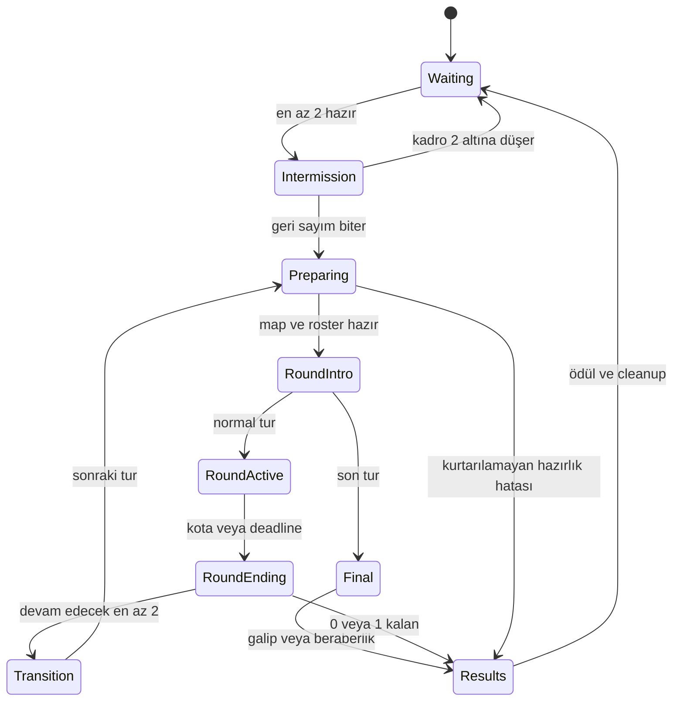

# Royal Rush — Ana oyun tasarımı

Belge sürümü: **1.0** · Tarih: **9 Ekim 2026** · Durum: **çalışma tasarımı**.
Kaynak/harita/place uygulaması `0.1.0-offline` olarak hazırlandı. Gerçek Studio,
çok oyunculu, Cloud ve telefon kabulü henüz yapılmadı; sayısal denge değerleri
ilk test ayarıdır. Güncel kapsam ve değişiklikler [uygulama durumunda](UYGULAMA-DURUMU.md).

## 1. Oyunun değişmeyecek çekirdeği

**Royal Rush: oyuncular okunabilir kaos olayları altında parkurlarda yarışır,
turları geçer ve finalde tek bir oyuncu tacı kazanır.**

Kimlik: fantastik yarışma programı + parkur + eleme turnuvası.
Markanın iki ana görseli **mor CHAOS** ve **altın CROWN**.

| Karar | Çalışma tasarımı |
| --- | --- |
| Çalışma adı | Royal Rush; isim uygunluğu yayın hazırlığında ayrıca kontrol edilir |
| Platform | Roblox; önce mobil ve PC, sonra konsol |
| Sunucu kapasitesi | Toplam 16 oyuncu; en az 2 kişiyle maç |
| Kamera / hareket | Roblox üçüncü şahıs, standart hareket ve zıplama |
| Ek kontrol | Tek Power butonu; PC'de Q, mobilde erişilebilir dokunmatik buton |
| Maç hedefi | 13–16 kişiyle genellikle 6–10 dakika; daha küçük maçlar daha kısa |
| Tur hedefi | Normal koşullarda 45–120 saniye; erken bitiş mümkün |
| Bekleme | Maç öncesi 20 saniye; yeterli oyuncu kalmazsa geri sayım durur |
| Adalet | Beceri ve adaptasyon sonucu belirler; ödeme fiziksel avantaj sağlamaz |

"%70 beceri, %20 adaptasyon, %10 kaos" bir tasarım yönüdür. Oyuncu başarısını bu
yüzdelere ayırdığımızı iddia etmiyoruz. Aynı rota, yetenek ve olayları tekrar
deneyen kişinin öğrenerek daha iyi sonuç alması beklenir.

## 2. Orijinal fikirde değiştirilen kararlar

| Konu | Yeni karar | Gerekçe |
| --- | --- | --- |
| 2–4 kişilik maçta üç tur | 2 kişi doğrudan final; 3–4 kişi bir qualifier + final | Az oyuncuyu gereksiz eleme turlarında bekletmez |
| Her maç 6–10 dakika | Bu süre tam sunucu hedefi; düşük oyunculu format kısa | Oyuncu sayısı ve erken bitiş gerçeğiyle uyumlu |
| Her yeni oyuncu 30 saniyede ana yarış | Boş/bekleyen sunucuda hedef; devam eden maçta hemen kısa pratik + açık bekleme bilgisi | Tek sunucuda sürmekte olan turnuva kesilemez |
| Race'te her düşüş anında eleme | Güvenli checkpoint dönüşü ve zaman kaybı; süre/qualification sınırı sonunda eleme | İlk zıplamadaki hata bütün oturumu bitirmez |
| Finalde 2–3 güçlü Chaos | En fazla 1 oynanış olayı + 1 görsel olay | Sonuç okunabilir kalır; kaçınılmaz kombinasyonlar azalır |
| Finalde herkesin aynı güvenli platformda beklemesi | Crown Climb: yükselen lav altında tacı ilk alan veya tek yaşayan kazanır | Collision kapalıyken finalin sadece bekleme/beraberliğe dönüşmesini önler |
| Yeni güçlerin yüksek level'da açılması | Rekabet güçleri ücretsiz; Dash varsayılan, Double Jump loadout'ta açık | Yeni oyuncu sırf progression yüzünden dezavantajlı başlamaz |
| Phase | Launch kapsamından çıkarıldı | Oyuncu çarpışması kapalıyken özgün faydası yok |
| Dev/küçük oyuncu | İlk sürümde yok; ileride sadece güvenli görsel değişiklik | Hitbox ve zıplama erişimi avatar boyuna göre bozulmaz |
| Survival süresi dolunca rastgele eleme | Açık overtime; hâlâ yaşayanları zorla rastgele eleme yok | Eşit başarı rastgele cezalandırılmaz |
| Rising Lava hem tur hem event | İlk sürümde harita/tur kuralı | Aynı tehlikenin iki sistem tarafından çakışmasını önler |
| Rastgele günlük sandık / VIP reroll | Bilinen ödül veya oyuncunun seçtiği kozmetik | Ekonomiyi anlaşılır tutar; ücretli rastgele ödül gerektirmez |
| Özel sunucu / düello global win kasma | Küçük maç ve özel maç sonuçları global rekabet kayıtlarından ayrı | Kolay tekrarlı eşleşme leaderboard'u belirlemez |
| Büyük shop önce | Sekiz oyunculu tam akış ve ikinci maç testi önce | Oyunun temel döngüsü tutmadan içerik yükü büyümez |

Bu değişiklikler oyunun Chaos + Crown kimliğini korur. Son denge, harita eğlencesi
ve görsel kalite gerçek oyuncu testlerinden sonra revize edilir.

## 3. İlk giriş, queue ve lobby

Oyuncu doğrudan küçük bir 3D lobby'de spawn olur. Önünde Crown Portal ve kolay
birkaç zıplamadan oluşan pratik alanı; üstte mevcut maç veya geri sayım bulunur.
Varsayılan olarak sonraki maça katılır. AFK/queue kapatma seçeneği görünürdür.
Portal katılım durumunu gösterir; otomatik queue varken zorunlu ikinci onay istemez.

Üç kısa, kapatılabilir ipucu: "Reach the finish", "Survive Chaos", "Claim the Crown".
Hareketi durdurmaz, yükleme veya oyun başlangıcını bekletmez. İlk 10 saniyede
oyuncu nereye koşacağını ve tacın nasıl kazanıldığını anlayabilmelidir.

- Bekleyen sunucuda en az iki hazır oyuncu olduğunda 20 saniyelik geri sayım başlar.
- Hazırlık ve kısa girişle ilk ana turu 30 saniyede başlatmak bir test hedefidir.
- Aktif maç sırasında gelen oyuncu bu maçın yarışmacısı olmaz; sonraki maça yazılır.
- HUD "MATCH IN PROGRESS / NEXT MATCH" ve kalan aşamayı gösterir; kesinliği olmayan
  bir başlangıç saniyesi vaat etmez. Spectate ve pratik hemen kullanılabilir.
- Pratik, maç ödülü veya win üretmez. Kısa rota ve kişisel süreyle hareket öğretilir.
- Aynı sunucuda kalan elenen oyuncular otomatik olarak sonraki maça hazırlanır.

Lobby yerleşimi: merkezde portal; yakınında taht; iki yanda loadout ve shop;
arkada leaderboard; kenarda daily reward. İlk prototipte portal, taht, loadout ve
pratik yeterlidir. Etkileşim noktaları aynı anda ekranı menülerle doldurmaz.

## 4. Kesin maç formatı

Başlangıç kadrosu Preparing'de sabitlenir. Yeni katılanlar bu kadroya eklenmez.
Aşağıdaki sayılar **normal akış hedefleri**dir; kopma veya daha az finisher varsa
gerçekte kalan oyuncu sayısıyla devam edilir.

| Başlangıç | Race sonrası | Survival sonrası | Rising Danger sonrası | Finale giren |
| ---: | ---: | ---: | ---: | ---: |
| 2 | — | — | — | 2 |
| 3 | 2 | — | — | 2 |
| 4 | 2 | — | — | 2 |
| 5 | 4 | 2 | — | 2 |
| 6 | 5 | 3 | — | 3 |
| 7 | 6 | 3 | — | 3 |
| 8 | 6 | 4 | — | 4 |
| 9 | 7 | 5 | 3 | 3 |
| 10 | 8 | 5 | 3 | 3 |
| 11 | 9 | 6 | 4 | 4 |
| 12 | 9 | 6 | 4 | 4 |
| 13 | 10 | 7 | 4 | 4 |
| 14 | 11 | 7 | 4 | 4 |
| 15 | 12 | 8 | 4 | 4 |
| 16 | 12 | 8 | 4 | 4 |

Format örnekleri: **8 → 6 → 4 → 1** ve **16 → 12 → 8 → 4 → 1**.
2 kişilik düello gerçek bir maçtır; sahte oyuncu veya garanti galibiyet yoktur.

Başlangıç timer ayarları:

| Format | Race | Survival | Rising Danger | Final | Beklenen toplam hedef |
| --- | ---: | ---: | ---: | ---: | --- |
| 2 kişi | — | — | — | 70 sn | 1–3 dakika |
| 3–4 kişi | 75 sn | — | — | 75 sn | 2–4 dakika |
| 5–8 kişi | 90 sn | 75 sn | — | 90 sn | 4–6 dakika |
| 9–16 kişi | 110 sn | 90 sn | 100 sn | 100 sn | 6–10 dakika |

Giriş en çok 3 saniye, normal tur geçişi yaklaşık 6 saniye, sonuç gösterimi
yaklaşık 8 saniye. Süreler oyuncuyu bekletmek için yapay olarak uzatılmaz.

### Tur sonuçları ve uç durumlar

**Race:** server tarafından doğrulanmış ilk K finisher qualify olur. Kontenjan
dolunca tur biter. Süre biterse yalnızca gerçekten bitirenler devam eder.

**Survival / Rising Danger qualifier:** yaşayan sayısı hedef K'ya düşünce yaşayanlar
qualify olur. Süre sonunda sayı daha fazlaysa 3 saniye uyarıyla en çok 20 saniye
overtime başlar. Hâlâ daha fazla kişi yaşıyorsa hepsi devam eder; sonraki kontenjan
yeniden hesaplanır. HUD bu sonucu açıkça bildirir. Final arena güvenlik açısından
16 katılımcıya kadar çalışır; 2–4 kişi normal hedeftir, zorunlu rastgele kesme yoktur.

**Final:** MVP'de **Crown Climb**. Yükselen lav altında kısa parkurun tepesindeki
taca ilk geçerli ulaşan veya rakipleri elenip tek yaşayan kazanır. Başlangıç HUD'u
"Reach the Crown. Don't fall." der; iki kazanma koşulu önceden açıktır. Finalde
tek galip vardır; ölenden sonra dirilme veya checkpoint yoktur. Saf Last Survivor
gelecekte ayrı, adalet ve süre testinden geçen final çeşidi olabilir.

**Tek kişi kaldı:** geçerli round sonucuyla veya rakiplerin ayrılmasıyla kalan
oyuncu yerel maç galibi olur. Rekabet ödülü ayrıca katılım uygunluğuna göre verilir.
Maç başlamadan kadro tek kişiye düşerse Waiting'e dönülür; boş zafer verilmez.

**Race'te sıfır finisher:** aynı maçta en fazla bir kez kolaylaştırılmış 60 saniyelik
yeniden deneme; Chaos kapalı. Yine sıfırsa maç kazanan olmadan biter. Checkpoint
ve rota problemi test kaydına girer; ölen oyuncu keyfî şekilde qualifier yapılmaz.

**Bütün oyuncular aynı simulation adımında öldü:** final ve survival sonucu beraberlik.
Ölümler aynı toplu değerlendirmede işlenir; event callback sırası kazanan seçmez.
Önceden hak edilmiş ödüller korunur, win bonusu verilmez, lobby'ye dönülür.

**Final hard cap:** normal timer sonrası 3 saniye uyarıyla en çok 20 saniye açık
overtime. Lavın yükselme hızı artar; taca giden önceden görülen rota hâlâ
ulaşılabilirdir. Hâlâ birden fazla oyuncu ve geçerli crown finisher yoksa beraberlik;
rastgele taç dağıtılmaz. Aynı server değerlendirmesinde ayırt edilemeyen crown
geçişi de beraberliktir; UserId veya callback sırası galibi belirlemez.

**Bitiş beraberliği:** aynı server örneklemesinde kontenjan sınırını birlikte geçen
ve ayırt edilemeyen geçerli finisher'lar birlikte qualify olur. Kontenjan eşit
durumdaki geçerli grubun tamamını kapsayacak kadar esneyebilir.
Client'ın gönderdiği süre veya ping tahminiyle kazanan seçilmez.
Kaydedilmiş daha hassas server geçiş bilgisi varsa o kullanılır.

**Maçtan ayrılma / reset:** aktif yarışmacı ayrılmış veya elenmiş sayılır; rejoin
mevcut maça geri sokmaz. Race reset'i son checkpoint dönüşüdür; final reset'i
elemedir. Spectator veya lobby dönüşü yarışmaya yeniden katılım değildir.

**AFK:** queue kapatılabilir. Hazırlıkta yüklenemeyen oyuncu güvenli biçimde lobby'de
kalır. Aktif turda ilk 20 saniye boyunca server'ın gördüğü anlamlı hareket/progress
yoksa AFK uyarısı ve kısa kontrol sonrası queue dışına alınır; sadece tek konum
örneğiyle eleme yoktur. Loading, spawn kilidi ve ağ kopması AFK ile karıştırılmaz.
İnaktif oyuncu maç katılımı ödülünü alamaz. Hareket yeniden başladığında bir
sonraki maç queue'suna kendi isteğiyle dönebilir.

## 5. Hareket, parkur ve güç dengesi

Kontrolü özgün hareket motoruyla gereksiz yere değiştirmiyoruz. İlk prototip ayarı
WalkSpeed 16 stud/sn ve JumpHeight 7.2 stud; bunlar kesin denge kabulü değildir.
Normal rotada geniş iniş alanları ve yaklaşık 4–6 stud boşluklar başlangıç ölçüsü.
Ana platform genişliği yaklaşık 10–12 stud; hassas köprülerde bile okunabilir
kenar ve yeterli pay. Daha riskli kısa yol isteğe bağlıdır.

Her zorunlu rota **güç kullanmadan** tamamlanabilir. Power daha hızlı çizgi veya
hata kurtarma sağlar. Mobil oyuncunun yapamadığı pixel-perfect jump, zorunlu
kamera çevirmesi ve ilk görüşte okunmayan sahte zemin ana rotada bulunmaz.

Standart R15 boyutları ve tutarlı gameplay gövdesi kullanılır. Avatar aksesuarları
tehlike hitbox'ını büyütmez. Karakterler birbirini itmez. Bump Mode launch dışında.
Hareketli platformun oyuncuyu taşıması, iniş kenarları ve dash sırasında duvara
çarpma ilk map testinin parçasıdır; görsel hareket yeterli kabul edilmez.

| Power | İlk ayar | Sınır |
| --- | --- | --- |
| Dash | 10 sn cooldown; yaklaşık 0.2 sn, 10–12 stud ileri destek | Geçerli yön, duvar kontrolü; teleport veya dokunulmazlık değil |
| Double Jump | 10 sn cooldown; havada bir ek itiş | Uçuş başına bir kullanım; yere inmek cooldown'u sıfırlamaz |
| Shield, Public V1.0 | 25 sn cooldown; 2 sn içinde bir knockback darbesini engeller | Void, lav veya qualification süresini engellemez |

Dash varsayılan seçilir; Double Jump ilk günden ücretsiz loadout seçeneğidir.
Shield geldiğinde herkese ücretsiz sunulur. Level, XP veya Robux cooldown, hız,
menzil, shield sayısı ya da güç sahipliğine avantaj vermez. Level ödülleri title,
trail ve diğer kozmetiklere gider. Air Boost ve Grapple sonraki sürümlere bırakılır.

Seçilen power Preparing'de maç için kilitlenir. Turlar arasında loadout değişmez.
Her yeni turun başlangıcında cooldown hazırdır. Lobby, spectator, countdown ve
results durumunda rekabet power'ı çalışmaz. Low Gravity ile Double Jump için
toplam yükselme/ileri erişim sınırı birlikte test edilir; hızlar çarpılarak büyütülmez.

Race düşüşünde son server checkpoint'ine dönülür; yaklaşık 1 saniye toparlanma
beklemesi ve geri yürünecek mesafe zaman kaybettirir. Aktif tehlikeye yeniden
spawn olmaz. Bu koruma sırasında ilerleme/finish kabul edilmez ve power açılamaz.
Survival ve final düşüşünde doğrudan eleme vardır. Perfect, düşüş veya checkpoint
dönüşü olmadan qualification'dır; checkpoint bölgesinden normal geçmek Perfect'i bozmaz.

## 6. Haritalar, obstacle ve segment sistemi

### İlk içerik

1. **Sky Kingdom — Crownway:** mavi/beyaz taş, altın köprüler, bulutların üstünde
   geniş okunabilir Race. İlk 15 saniye kolay; sonra hareketli platform, spinner,
   süreli kapı ve riskli kısa yol. Bitiş uzaktan görünür.
2. **Lava Factory — Foundry Arena:** koyu zemin üzerinde belirgin tehlike rengi;
   alt survival alanı, yukarı çıkan güvenli rotalar ve final arena düzeni.
   Survival / Rising Danger / Crown Climb kurallarıyla kullanılabilir.
3. **Neon City — Rooftop Rush:** Public V1.0'da çatı Race haritası; reklam panoları,
   tren/işaret hareketi, laser kapılar ve rüzgâr bölgeleri. Temel rota aydınlık kalır.

İlk prototipte ikinci haritanın sanat üretimi yerine basit Crown Arena greybox'ı
kullanılabilir. Bu, tamamlanmış Lava Factory veya üçüncü gerçek map diye sayılmaz.
MVP'deki iki gerçek map ayrı rota/geometriye sahip olmalıdır; renk değiştirmek yeni map değildir.

### Modüler obstacle listesi

MVP'de 10 tip: MovingPlatform, RotatingBeam, Spinner, FallingTile, Conveyor,
JumpPad, PushWall, DoorTiming, ThinBridge, Elevator.
Public V1.0 ekleri: SwingHammer, Crusher, LaserGate, RollingBall, FanWind.
Piston, MovingBridge, BalancePlatform, RotatingCylinder ve diğerleri içerik havuzu.

Her modelin Init / Start / Stop / Cleanup yaşam döngüsü; tanımlı başlangıç durumu;
server tarafından yönetilen tehlike sınırı bulunur. Parametreler hız, mesafe, yön,
başlangıç gecikmesi, pause, faz ve döngü süresidir. Map unload bütün bağlantı,
görev ve geçici instance'ları temizler.

Start ve End bağlantıları; rota genişliği, zemin yüksekliği, clearance ve güvenli
spawn payı segment sözleşmesine girer. Metadata: Difficulty, Length, Theme,
SupportedEvents, Min/MaxPlayers, MobileDifficulty, RequiredClearance.

Önce elle düzenlenmiş ve test edilmiş haritalar. Sonra bu güvenli segmentlerin
kontrollü kombinasyonu. Tamamen rastgele geometri launch için gerekli değildir.
Üretilen rota erişilebilirlik ve event uygunluğunu geçmezse test edilmiş sabit
rotaya dönülür. Her turun map/segment/event seed'i hata tekrarına yardımcı olmak
için saklanır; bu kayıt birebir fizik replay garantisi değildir.

## 7. Chaos: okunabilir sürpriz

Her event önce yaklaşık 3 saniye uyarılır; yerel tehlike ayrıca zeminde/obstacle'da
gösterilir. Devreye girdiği server zamanı HUD'a gönderilir. Etki bitince tüm
modifikasyonlar geri alınır. Round değişimi de bu temizliği zorunlu yapar.

### MVP: dört event

| Event | Tier / başlangıç süresi | Oynanış ve güvenlik kuralı |
| --- | --- | --- |
| Low Gravity | Common / 12 sn | Daha uzun havada kalma; erişim ve Double Jump sınırı map üzerinde test edilir |
| Super Speed | Common / 10 sn | Yaklaşık %15 hız artışı; bütün rota hızlanma altında hâlâ geçilebilir |
| Vanishing Platforms | Rare / 8 sn | Önce yanıp sönen seçili yan platformlar; ana rotada kesintisiz güvenli geçiş kalır |
| Meteor Shower | Epic / 12 sn | Her isabetten önce en az 2 sn zemin işareti; kaçış alanı ve oyuncu yoğunluğu kontrol edilir |

Meteor spawn, bitiş ve checkpoint toparlanma alanına isabet etmez. Görsel meteor
ile server'ın hasar alanı aynı yer/zamanda olur. Güvenli alan göstergesi geometri
arkasında kaybolmaz. Gerçek mobil tepki testi geçmezse daha geniş alan veya daha
uzun uyarı kullanılır; sayıyı artırmak çözüm değildir.

### Public V1.0: toplam sekiz event

Yukarıdakilere Shockwave (Rare), Falling Tiles (Rare), Neon Mode (Common) ve
The World Is Breaking (Legendary) eklenir. World Is Breaking, önceden işaretlenmiş
parçaları sırayla çökertir; kaçış seçeneklerini eşzamanlı kapatmaz. Neon Mode
yalnızca görseldir; tehlike/güvenli renklerini değiştirmez.

Heavy Gravity, Slow Motion, Fog, Darkness, Giant/Tiny Players, Banana Rain ve
Moving Walls havuzda tutulur; adalet veya performans testleri olmadan açılmaz.
Rising Lava ilk sürümde bir round kuralıdır; ikinci bir Chaos lava sistemi yoktur.

### Event seçim sözleşmesi

EventConfig: ID, rarity, duration, allowedRoundTypes, incompatibleEvents,
minPlayers, mapTags, segmentTags, impactCost, difficultyMultiplier, cooldown,
telegraphTime, safeAreaRules, handlerVersion.

1. Önce map, roster, round ve aktif olaylara uymayanları ele.
2. Kalan rarity tier'leri arasında 60/25/10/5 ağırlıklarını yeniden normalize et.
3. Seçilen tier içindeki geçerli event'i ağırlıkla seç; yakın tekrarları azalt.
4. Geçerli seçenek yoksa event'i atla. Güvensiz kombinasyona mecburi fallback yok.
5. Round için ayrı server seed'i ve seçim gerekçesini kaydet.

MVP'de Legendary yoktur; onun %5 ağırlığı varmış gibi vaat edilmez. Tier oranları
her seçimin uygun havuzunda geçerlidir, maçların toplam dağılımı değildir.
Tier etiketi otomatik öldürücülük anlamına gelmez. Legendary güçlü görsel an olabilir.

| Aşama | Toplam olay hedefi | Eşzamanlı etki sınırı |
| --- | --- | --- |
| Round 1 | 1; referans Race'te 27. sn uyarı, 30. sn aktivasyon | 1 gameplay |
| Round 2 | 1–2 | İlk MVP'de sırayla; yalnızca test edilmiş kombinasyon örtüşebilir |
| Round 3 | 2 | En çok 2 hafif etki; iki öldürücü tehlike birlikte değil |
| Final | 1 gameplay + isteğe bağlı 1 görsel | En fazla 1 gameplay |

Tur erken bittiyse planlanan event iptal edilir; oyuncuyu event gelsin diye bitişte
bekletmeyiz. First build parkur uzunluğu normal bitişlerin 30 saniyelik kaosu
deneyimlemesini sağlayacak şekilde test edilir.

Uyumsuz örnekler: Meteor + Falling Tiles aynı alan/zamanda; Vanishing + World
Breaking; Low Gravity + ağır yerçekimi; Super Speed + yeterli fren mesafesi
olmayan crusher segmenti. Finalde Rising Lava tur kuralı da etki bütçesinin parçasıdır;
lav zaten ana tehlikeyken ek event öldürücü bölge üretmez. Low Gravity veya görsel
event gibi uygun seçenekler kullanılabilir.

Lobby oyuncularını bozmak için bütün Workspace.Gravity'yi körlemesine değiştirmeyiz.
Low Gravity uygulamasının aktif yarışmacıya/arenaya etkisi M4'te ölçülür. Ortak
fizik özelliği kullanılacaksa lobby, spectator ve reset durumları da doğru kalmalıdır.
Spawn, cooldown, hız, platform görünürlüğü ve lighting temizliği tekrar test edilir.

## 8. HUD, spectator, ses ve görünüm

Round HUD: üstte tur adı ve kazanma hedefi; Race'te Qualified X/K, Survival'da
Alive X; sağ üstte timer. Tek power ve cooldown; mobil jump/joystick ile çakışmaz.
Telefon safe area, küçük ekran ve yatay ekran test edilir. Metin ve ikon birlikte
kullanılır; renk tek başına bilgi taşımaz. Ana metinler yerelleştirilebilir anahtarlardır.

Elenme: ELIMINATED, açık neden, kazanılan ödül; Spectate / Lobby. Doğru sıralama
olmayan Survival'da uydurma "#9" yazılmaz. Qualification: gerçek finish sırası,
Perfect veya son bir saniyede CLUTCH. Server deadline esastır.

Spectate: yaşayan oyuncuya bağlanır, önce/sonra tuşu ve oyuncu adı; izlenen kişi
ölür/ayrılırsa bir sonraki canlıya geçer. Kimse kalmazsa lobby kamerası. Kamera
respawn, final ve maç dönüşünde normale alınır. Stream edilmemiş oyuncunun
görünebildiği doğrulanmadan kamera boşluğa bağlanmaz.

Final giriş filmi en fazla 3 saniye ve atlanabilir. Kazanma hedefi sırasında
kameraya el koyulmaz. Sonuçta kazanan taht/seremoni alanında, taç ve sınırlı
confetti ile gösterilir. Oyun üstünlüğü vermeyen Server King etiketi sonraki maç
başlayana kadar kalır. Kazanan ayrılırsa aynı avatarı sonsuz canlı model olarak
tutmak yerine temizlenen görsel kayıt kullanılabilir.

Renkler: güvenli/qualification yeşil; tehlike kırmızı + şekil; zafer altın;
Chaos mor; Power mavi. İniş yerleri ve hazard kenarları arka plandan ayrılır.
Kamera titremesi hafif ve kapatılabilir; VFX oyuncuyu veya rota bilgisini örtmez.

İlk ses seti: countdown, chaos warning/start, qualification, elimination, final,
victory, UI click, power. Lobby/round/final müzikleri ayrı yoğunlukta; victory
jingle 3–5 saniye. Sahip olunan veya lisansı doğrulanmış sesler kullanılır;
geçersiz/uydurma asset ID'leri tamamlanmış ses sistemi sayılmaz.

Ayarlar: Music/SFX Volume, Reduced Shake, Reduced Particles, Color Assistance,
Auto Spectate, Low Effects. Kamera ayarı standart Roblox kontrolleriyle uyumlu
olur. Accessibility ayarı hitbox, event süresi veya yarış üstünlüğünü değiştirmez.

## 9. Progression, sosyal prestij ve ekonomi

Kalıcı profil: DataVersion, TotalXP, Wins, LocalWins, Crowns, BestStreak,
SelectedPower, OwnedCosmetics, EquippedCosmetics, QuestProgress, DailyState,
Settings, Statistics, TutorialVersion ve işlem tekrarını önleyen kayıtlar.
Level, TotalXP'den tek formülle türetilir. Yeni DataVersion migration ile açılır;
eski kayıt okunamadı diye sıfırlanmaz.

Stats: RoundsPlayed, Qualifications, FinalsReached, Perfects, Clutches ve
PowerUses. Aktif WinStreak mevcut server oturumuna aittir; BestStreak kalıcıdır.
Katılınan rekabet maçında kaybetmek/ayrılmak streak'i bitirir; queue dışı kalmak
streak'i artırmaz. Streak tanımı UI'da görünür.

### Ödül taslağı

| Eylem | XP | Crowns | Sınır |
| --- | ---: | ---: | --- |
| Aktif maç katılımı | 40 | 5 | En az 20 sn geçerli aktif oyun; maç başına bir |
| Qualification | 50 | 15 | Aynı round başına bir |
| Finale erişim | 75 | 20 | Maç başına bir |
| Standart maç kazanma bonusu | 250 | 60 | Geçerli sonuç, bir kez |
| Perfect | 10 | 0 | Aynı qualification için bir kez |

CLUTCH ilk sürümde güçlü görsel kutlamadır; oyuncunun bitişi geciktirip ödül
kasmasını teşvik eden yüksek ekstra para yoktur. Üstteki ödüller birbiriyle
toplanır; önceden verilen katılım ödülü results'ta ikinci kez eklenmez.

Crowns yalnızca kozmetik para birimi; Wins ayrı başarı sayacıdır. İlk kozmetik
yaklaşık 75–100 Crowns bandında test edilir. Oyuncu kazanamasa da birkaç aktif
maçta bir satın alma/ödül deneyimi hedeflenir. Ekonomi maç sonu gerçek kazanım
verileriyle ayarlanır; saatlerce güç grind'ı yoktur.

**Rekabet uygunluğu:** maç başlangıcında en az 4 oyuncu olan public sunucu ve
gerçek aktif rakip katılımı global Wins/BestStreak için gereklidir. Kazanma bonusu
bu uygunluğa bağlıdır. 2–3 oyunculu maçlar LocalWins, katılım/qualification/final
ödülü ve daha küçük yerel win bonusu (başlangıç ayarı 100 XP / 20 Crowns) verir;
Server King yine olabilir. Ayrım maç başlamadan HUD'da yazılır.

Private sunucularda yerel sonuçlar vardır; global Wins/BestStreak ve rekabet
badges artmaz. Kalıcı XP/Crowns verilmesi kontrollü düşük oranla test edilir;
ilk private test build'inde üretim progression'ı kullanılmaz. Tekrarlı kolay
eşleşmelerin para üretimi sınırlanır; yeni oyuncu otomatik exploit ilan edilmez.
Bu kurallar farming'i bütünüyle çözdüğü iddiası değildir.

Streak 5/10 prestij etiketi; yüksek streak'i finalde yenmek ileride kozmetik
achievement olabilir. Başka oyuncuyu hedef alıp itme/öldürme ödülü yoktur.
FRIEND VS FRIEND gerçek arkadaşlık bilgisiyle kozmetik sunumdur; sonucu değiştirmez.

MVP arkadaşların Roblox üzerinden aynı sunucuya katılmasına uygun olacaktır.
Public V1.0'da mümkün olduğunca aynı sonraki maç kadrosuna girme ve arkadaş
spectate akışı test edilir. Ayrı parti backend'i ilk hedef değildir. Büyük parti
ve sunucu doluluğunda aynı maç garantisi verilmez. Party XP bonusu gerekli değil;
eklenirse yalnızca kozmetik ilerlemesine etkisi ayrıca ölçülür.

### Shop ve Robux

MVP: 4–6 sabit fiyatlı Crowns kozmetiği; trail/title ağırlıklı, bir victory sunumu.
Public V1.0: yaklaşık 12–16 kozmetik; Featured, Trails, Auras, Victory, Titles.
Robux sekmesi ancak güvenli satın alma işlemleri test edildikten sonra açılır.
Önce VIP görünüm/title/trail gibi kozmetik paketler; Crowns paketleri zorunlu değil.

Güç satışı/yükseltmesi, revive, maç içi ücretli kurtarma, luck boost ve ücretli
rastgele sandık yoktur. VIP, qualification, XP ile güç erişimi veya cooldown avantajı
vermez. İkinci premium currency eklemiyoruz. Fiyatlar bu planda sabitlenmiyor.

Robux ile alınabilen para üzerinden rastgele ödül satışı da Roblox'un ücretli
rastgele item kurallarına girer. Bu tasarım onun yerine garanti kozmetik kullanır.
[Roblox paid random items rehberi](https://create.roblox.com/docs/production/monetization/paid-random-items).

Daily: 7 günlük ödül yolu; kaçırılan gün bütün geçmişi sıfırlamaz. Günlük claim
server'ın 00:00 UTC gün sınırına göre bir kez; UI yerel kalan süreyi gösterir.
Her geçerli claim ödül yolunda bir adım ilerler; kaçırılan gün adımı geri almaz.
Beşinci/yedinci gün bilinmiş kozmetik veya seçim
hakkı; satın alınan reroll yok. Aynı kozmetik sahipliği kontrollü telafiye dönüşür.
Günlük üç görev; qualify, power, final, chaos survive çeşitleri. "Win" görevinin
düşük CCU'da tamamlanabilir alternatifi vardır. Weekly Quest V1.1'e kalır.

İlk badges: First Crown, First Final, Perfect, Clutch, 10 Wins, 5 Streak.
Arkadaş yenme, legendary survive, 100 wins ve 10 streak daha sonra. Başarı sadece
server doğrulamasından doğar; platform badge çağrısı başarısızsa tekrar denenir.

## 10. Teknik temel ve güven sınırı

### Server/client ayrımı

Server belirler: roster, state, map, qualification, elimination, timer/deadline,
winner, event seçimi/etkisi, power uygunluğu/cooldown, XP, Crowns ve satın alma.
Client: giriş, kamera, HUD, yerelleştirme, ses ve kozmetik VFX. Client'ın
"kazandım / para ekle / süreyi değiştir" komutu kabul edilmez.

Standart Roblox ağ sahipliği client fizik verisine güvenebilme anlamına gelmez;
Touched tek başına güvenli qualification veya hasar kanıtı değildir. Finish için
server bölge/rota/checkpoint/geçerli hareket değerlendirmesi gerekir.
[Roblox network ownership](https://create.roblox.com/docs/physics/network-ownership).

Güncel Roblox server authority modeli ayrı motor ayarları ve simulation/input
yapısı gerektirir. M0'da kullanılan Studio'da mevcutluğu ve küçük hareketli
platform + Dash testi değerlendirilecek. Uygunsa çekirdek bu modele göre kurulur;
uygun değilse standart hareket + server doğrulama seçilir ve bunun tam otoriter
karakter simülasyonu olmadığı belgelenir. Motor modeli ilk oynanabilir map'ten
önce karara bağlanır; sonradan küçük bir ayar gibi değiştirilmeyecek.
[Roblox server authority modeli](https://create.roblox.com/docs/projects/server-authority).

### State machine

Transition yeni maçı değil aynı maçın sonraki turunu hazırlar; roster ve loadout
kilidi korunur. Bütün durumların timeout/iptal yolu vardır. State tek yerde
değişir. Her mesaj matchId, roundId ve stateVersion taşır. Eski turdan kalmış
callback yeni turda finish, ölüm, power veya ödül üretemez.

| Servis | Tek sorumluluk |
| --- | --- |
| MatchService / StateMachine | Maç yaşam döngüsü, roster, geçişler |
| RoundService | Aktif tur, qualification, timer, toplu ölüm değerlendirmesi |
| MapService | Map/segment yükleme, spawn, checkpoint, finish, unload |
| ObstacleService | Modüllerin parametreleri, hareketi ve cleanup |
| ChaosService | Geçerli havuz, seed, uyarı, start/stop ve geri alma |
| PowerService | Loadout snapshot, aktivasyon ve cooldown doğrulaması |
| PlayerDataService | Profil, migration, session lock, save/retry |
| RewardService | Doğrulanmış sonuçlardan bir defa ödül hesaplama |
| CosmeticService | Sahiplik/equip ve görsel uygulama |
| QuestService | Tarih döngüsü, ilerleme ve bir defa claim |
| AnalyticsService wrapper | Gameplay ölçümü; başarısız analitik maçı durdurmaz |

Servisler gerektiği milestone'da uygulanır. İlk günden düzinelerce boş servis ve
hayalî çalışan shop oluşturulmaz. Shared modüller yalnızca config, tipler,
sözleşmeler ve seçilen fizik modeli gerektiriyorsa saf simulation mantığıdır.

### Remote ve hareket doğrulaması

- Her client isteğinde tip/boyut/sayı kontrolü; NaN/sonsuz değer reddi.
- Per-player ve per-action rate limit; aktif state, roundId, roster ve sahiplik kontrolü.
- Power için client'ın gönderdiği cooldown veya keyfî pozisyon kullanılmaz.
- Finish sıralı checkpoint/progress, server alanı, erişim süresi ve makul hareketle doğrulanır.
- Hız sınırı aktif Chaos, Dash, jump pad, platform taşıması ve gecikme payını bilir.
- Şüpheli tek frame otomatik ban değildir; kayıt, konum düzeltme ve tekrar kontrolü.
- Spectator, lobby veya başka turdaki oyuncu aktif harita trigger'ı kullanamaz.
- Tekrarlı finish/ölüm callback'leri aynı oyuncuya ikinci sonuç vermez.
- Hazard isabeti server'ın tanımlı hacmine dayanır; VFX client'ta üretilebilir.

### Profil ve satın alma dayanıklılığı

PlayerDataService dışında doğrudan DataStore çağrısı yok. Profil başına sıralı
işlem kuyruğu, session lock, UpdateAsync ve kontrollü retry kullanılır. İlk ayar
90 saniye autosave; PlayerRemoving ve BindToClose ayrıca save yapar. Test/dev
profil alanları üretimden ayrı tutulur.

Yükleme başarısızsa varsayılan profil gerçek veri üzerine yazılmaz. Geçici oyun
modu açıkça gösterilir; kalıcı ödül ve satın alma devre dışıdır. Kayıt hatasında
UI "kaydedildi" demez. Bağlantı/lock düzelmeden işlem sahipliği varsayılmaz.
Reward kaydı matchId/roundId ile tekilleşir; retry iki kez XP/Crowns eklemez.
Crash anındaki tamamen kaydedilmemiş ilerleme için sıfır kayıp garantisi verilmiyor.
[Roblox player data ve purchasing rehberi](https://create.roblox.com/docs/cloud-services/data-stores/player-data-purchasing).

Developer Product eklenirse ProcessReceipt tek merkezi server handler'dır;
PurchaseId, ürün/oyuncu ve profil uygunluğu doğrulanır. Ürün ve işlenmiş receipt
kalıcı kayıtta tutarlı şekilde saklanmadan satın alma onaylanmaz. Tekrar gelen
receipt yeniden ürün vermez. PromptProductPurchaseFinished ürün verme yolu
değildir. Bu katman test edilmeden gerçek Robux ürünleri açılmaz.
[Roblox Developer Products](https://create.roblox.com/docs/production/monetization/developer-products).

## 11. Performans ve ölçüm

Harita dışı objeler unload; meteor/confetti dekoru havuzlu ve sınırlı; gereksiz
unanchored fizik yığınları yok. Tehlike kararı server'da, yoğun görsel etki client'ta.
StreamingEnabled ile yarışma, spectator, geri spawn ve finish birlikte test edilir.
İniş platformu stream edilmeden oyuncu kontrolsüz boşluğa bırakılmaz. Model parçası,
particle sayısı ve gerçek ışıklar en kötü final görüntüsünde ölçülür.

Başlangıç kabul hedefleri: seçilen düşük/orta sınıf telefonda tipik 30 FPS veya
üstü; PC'de 60 FPS hedefi; 16 oyunculu Chaos sırasında belirgin sürekli takılma
yok. Bunlar henüz ölçülmedi. Cihaz modeli, grafik seviyesi, frame dağılımı,
bellek, server script/physics süresi ve bağlantı koşulu rapora yazılır. Tek PC'de
sekiz Studio client çalıştırmanın FPS'i gerçek telefon performansı sayılmaz.

Analytics'in ilk prototipte yerel kaydı; dışarıya gönderim sonraki entegrasyon.
new_player_join, tutorial_complete/skip, queue_enter, first_round_start/finish,
qualified, eliminated(reason), left_during_round, final_reached, match_win,
second_match_started ve match_duration kaydedilir. Shop/daily/purchase/party
ölçümleri ilgili sistem gerçekten eklenince açılır. Chat içeriği, özel dosya ve
gereksiz kişisel veri ölçüme katılmaz. İstemci UI olayı ekonomik gerçek sayılmaz.

KPI'lar: ilk yarışa erişim (bekleyen/aktif sunucu ayrı), ilk qualification,
ikinci maça geçiş, session süresi, round/player, D1/D7, friend join ve sonradan
purchase conversion. Sonuçlar yeni/deneyimli, mobil/PC ve format bazında ayrılır.

İlk kapalı testte 20–30 yeni oyuncu üzerinden şu sorulara bakılır: 10 saniyede
hedefi anlıyor mu; nasıl öldüğünü açıklayabiliyor mu; kendi isteğiyle ikinci maça
giriyor mu; kaçış ve power adil mi? Başlangıç ürün hedefi ikinci maça girişte %50+
olabilir; bu kanıtlanmış retention veya büyük kitle tahmini değildir. Tek küçük
örneklemden D1/D7 başarısı ilan edilmez. Sorun varsa daha fazla shop yerine temel
rota/event/tempo düzeltilir.

## 12. Sürüm kapsamı ve ertelenen işler

| Kademe | Çıkış koşulu / içerik |
| --- | --- |
| İlk oynanabilir prototip | Sekiz kişilik tam akış; greybox serbest; temel sonuç HUD'u, dört event, iki power, gerçek save testi |
| Kapalı MVP | 1 lobby, 2 gerçek map, 10 obstacle, 4 event, 2 power, XP/Crowns/save, spectator, 4–6 kozmetik, bir victory sunumu |
| Public V1.0 adayı | 3 map, 15 obstacle, 8 event, 3 power, daily/quests, 12–16 kozmetik, streak/Server King, leaderboard, arkadaş akışı, mobil/analitik testleri |
| V1.1 | Ölçüme göre 1 map + 3 event + gerekirse 1 anlamlı power, weekly quests ve yeni kozmetik |
| Daha sonra | Season, topluluk oylaması, kısa map vote, özel server ayarları, native party akışının genişletilmesi |

Ranked, revive, pet, trading, clan, crafting, battlepass, open world, NPC AI ve
50 power launch kapsamında değildir. Haftalık update sözü verilmeden önce içerik
üretim/test süresi ölçülür. Double Crowns ve Chaos Weekend ancak ekonomi ve
event güvenliği testinden sonra. FOMO ile baskı ve ödeme avantajı tasarım hedefi değildir.

Thumbnail/icon: taçlı karakter, okunabilir kırılan yol ve mor kaos; az metin.
Gerçek oyunda olmayan meteor yoğunluğu veya özellik gösterilmez. Açıklama kısa:
"Race. Survive Chaos. Reach the Final. Claim the Crown." Görsel art direction ve
haritanın eğlenceli olup olmadığı insan değerlendirmesiyle sonlandırılır.

## 13. Kaynak fikir kapsama kaydı

Kullanıcının 114 maddesi tek tek bağımsız feature talebi gibi uygulanmayacak;
aşağıdaki kümeler ana fikri ve hangi sırada ele alındığını korur.

| Orijinal maddeler | Bu tasarımdaki karşılık |
| --- | --- |
| 1–7 | Kimlik, ilk giriş ve kesin küçük/büyük maç formatları |
| 8–13 | İlk round türleri, uyumluluk filtresi ve Chaos bütçesi |
| 14–23 | Ücretsiz güçler, collision, checkpoint, eleme, spectator; revive ertelendi |
| 24–29 | Mobil zıplama ölçüleri, 10/15 obstacle, segment sözleşmesi ve üç tema |
| 30–35 | Lobby, taht/Server King, streak, arkadaş finali ve sade parti yaklaşımı |
| 36–50 | Profil, XP/Crowns, sabit kozmetik ekonomi, daily/quests/badges, Perfect/Clutch |
| 51–65 | HUD, finale/victory, ses, renk/VFX, cihaz ve erişilebilirlik |
| 66–80 | Güven sınırı, state machine, servisler, profil/receipt dayanıklılığı ve analitik |
| 81–87 | KPI, ilk oturum, AFK/disconnect, exploit ve private server sonuçları |
| 88–98 | Casual önce; ranked/season/live ops/voting sonra; marketing dili |
| 99–107 | MVP/Public kapsamı, milestone kabulü ve gerçek oyuncu başarı kriteri |
| 108–114 | Hareket + Chaos + eleme önceliği; yeniden oynama/sosyal nedenler; sekiz kişilik ilk akış |

Geliştirme sırasında değişen karar, gerekçesi ve test kanıtı bu belgeyle birlikte
güncellenecek. "Kusursuz" ürün ilanı yerine ölçülmüş, açık kusurları giderilmiş
ve yeniden oynanmak istenen bir oyun hedeflenir.
