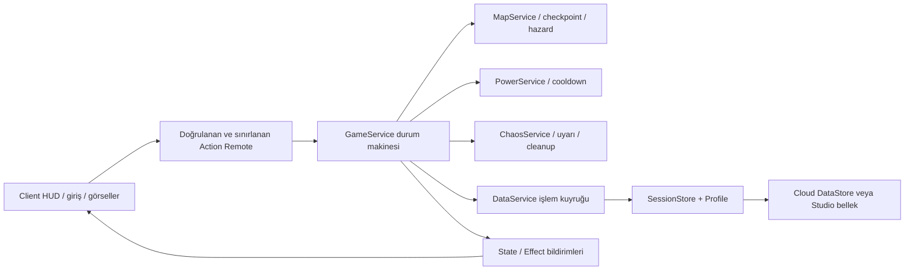

# Royal Rush 0.1.0-offline — Uygulama durumu

9 Ekim 2026. Kullanıcının Studio olmadan geliştirme talebi üzerine kaynak, gerçek
map modelleri ve açılabilir place üretimi tamamlandı. Aşağıdaki "uygulandı"
kelimesi kod/asset teslimini anlatır; gerçek Roblox runtime kabulü değildir.

9 Ekim sabah güncellemesi: mevcut Studio'da yerel `.rbxl` açıldı ve F5 ile
gerçek tek kişilik test yapıldı. Lobby/HUD, Sky Kingdom/Neon City yarışının
başlaması, Q/Dash + 10 saniye cooldown, sonuçtan lobby'ye dönüş ve sonraki maç
görüldü. İstemci ve sunucu F9 konsolları 0 hata/0 uyarı gösterdi.
Tam eleme/final, çok oyunculu ve kalıcı veri kabulü açık; ayrıntılı kanıt
`../evidence/studio-smoke-2026-10-09.md` içindedir.

| Bölüm | Teslimat | Kabul durumu |
| --- | --- | --- |
| M0 | Rojo/Lune/Luau, proje, build/test/open komutları | Offline doğrulandı; gerçek Studio ilk açılış geçti; 2 client açık |
| M1–M3 | Lobby, queue, state machine, Race/checkpoint, çok tur, final/sonuç/ikinci maç | Tek kişi lobby/Race/timeout/yeniden maç geçti; qualification/final kabulü açık |
| M4–M5 | 8 Chaos, uyum/rarity/cleanup, Dash/Double Jump/Shield | Q/Dash ve Super Speed uyarı/UI görüldü; tüm güç/kaos fiziği ve adalet açık |
| M6–M7 | Profil, XP/Crowns/wins, kilit/save/migration, HUD/spectator | Saf veri ve sahte transport testi geçti; Cloud/8 client açık |
| M8–M9 | Crowns shop, 14 kozmetik, daily/quest, streak/King/board/analytics | Transaction testi ve kaynak var; canlı/insan kabulü açık |
| M10 | 3 tema/5 layout/15 obstacle, UI, VFX, ses dosyaları | Statik map/GUI ve WAV kontrolü geçti; telefon/ses/insan polish açık |
| M11 | Payload şeması, rate limit, movement toleransı, server kararları | Offline kontrol var; gerçek exploit/ağ/perf kabulü açık |
| M12 | Local `.rbxl`/`.rbxlx`, kaynak paketi, manifest ve test listesi | Yerel hazırlık tamam; public yayın yapılmadı |

## Tasarımdan uygulamaya verilen kararlar

- Normal public sunucuda minimum 2; F5 Studio'da 1 kişiyle açıkça etiketlenen
  Race → Rising Danger → Final önizlemesi. StudioCloud=false; XP geçicidir.
- Race düşüşü checkpoint'e döndürür; süre/qualification asıl eleme sınırıdır.
  Survival/finalde lav/void ölüm eler. Shield lav ve void'i engellemez.
- 8 oyuncu hedefi 6 → 4 → 1; 16 hedefi 12 → 8 → 4 → 1. Survival overtime'ında
  hâlâ yaşayanlar birlikte geçebilir; kota uğruna rastgele öldürme yoktur.
- Aynı server örneklemesinde kotaya gelen Race eşitlikleri birlikte geçer.
  Finalde ayırt edilemeyen finish veya bütün oyuncuların aynı örneklemde ölmesi draw.
- Map yüklemesi başarısız yarışmacılar lobby'ye döner; fiili quota yeniden
  hesaplanır. Sonraki turda iki kişi kaldıysa doğrudan finale geçilir.
- Lobby'de seçili power denenebilir; kullanım quest/XP/win üretmez.
- İlk server maçının ilk Race'inde Low Gravity 30. saniyede; sonra uyumlu havuz.
  Güçlü event'ler bu build'de aynı anda yığılmaz; finalde en çok bir event.
- Ana rota event ile silinmez. Kaybolma/çökme sadece işaretlenen yan/outer floor'da.
  Meteor checkpoint/bitiş yakınından uzak tutulur; 2.2 s ön uyarı verir.
- Rising Danger lavı son güvenli deck'in altında durur; overtime aynı yerdeki
  bütün başarılı oyuncuları öldürmez. Final lavı sınırsız yükselir. Laser/knock
  kontrolleri iki örnek arasındaki geçişi de denetler; sadece son noktaya bakmaz.
- Üç power baştan ücretsiz. 13 shop öğesi + 1 ücretsiz title; yalnız Crowns.
  Robux ürünleri, ücretli rastgele sandık ve revive açılmadı.
- Global win: public/non-Studio, başlangıçta en az 4 oyuncu ve en az 2 aktif
  katılımcı. Küçük/özel maçlar LocalWins; global leaderboard'a gitmez.
- XP/ödül sayıları Config/Profile'da ilk test ayarıdır; ölçülmüş denge değildir.
- Renk yardımı tehlikeye `!`, kaybolabilen zemine `?`, jump pad'e `↑`, finishe `GO`
  ekler. Kamera sallanması bu build'de yok; ReducedShake tercihi geleceğe saklanır.

## Bilerek bu build dışında kalanlar

Platform badge ID'leri, özel party backend/friend-final bonusu, bounty, map voting,
weekly quest, power progression unlock, Robux satışları, sezon/ranked ve retention
dashboard'ı yok. Temel günlük görevler/achievement yerel profilde vardır. Analytics
wrapper canlı server'da LogCustomEvent çağırır; panelde göründüğü doğrulanmadı.

Statik GUI kontrolü 320×568, 390×844, 844×390, 1280×720 varsayılan safe rectangle'ları
içindir; gerçek cihaz inset/joystick/jump butonu ve FPS testinin yerine geçmez.
Statik parkur boşluğu/sıçrama yüksekliği kontrolü hava kontrolünü veya eğlenceyi
kanıtlamaz. Gerçek motor API'leri ilk Play'te ayrıca izlenir.

## Mimari

Server finish/ölüm/galip/ödül sahibidir. Hareket Roblox standart network modelidir;
speed/teleport tolerans kontrolü tam server authority değildir. Server maç seed'ini
seçer; map instance'ları unload edilir, event/force cleanup vardır.

Kaynaklar: [Rojo place build](https://rojo.space/docs/v7/getting-started/new-game/),
[Lune Roblox serialization](https://lune-org.github.io/docs/api-reference/roblox/),
[Roblox LinearVelocity](https://create.roblox.com/docs/reference/engine/classes/LinearVelocity),
[Player streaming](https://create.roblox.com/docs/reference/engine/classes/Player),
[AnalyticsService](https://create.roblox.com/docs/reference/engine/classes/AnalyticsService).
